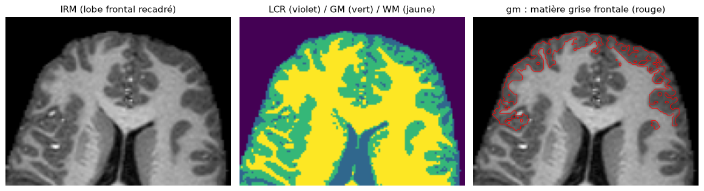
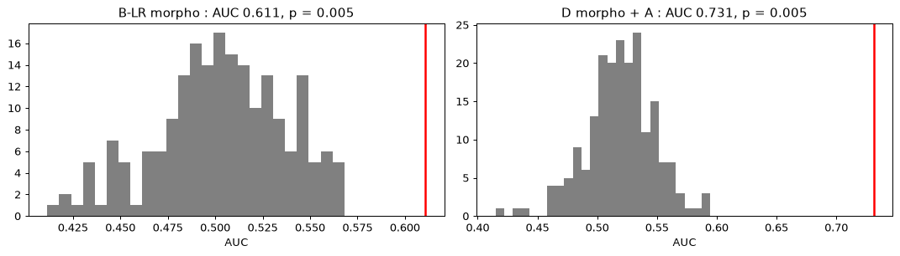

# Morphologie mathématique du lobe frontal et détection de l'ADHD

Classification ADHD / contrôle à partir d'IRM anatomiques 3D (base [ADHD-200](http://fcon_1000.projects.nitrc.org/indi/adhd200/)). Le lobe frontal de chaque enfant est décrit par 30 descripteurs de morphologie mathématique, qui servent d'entrée à des classifieurs simples.

## Pipeline

1. **Données** : tableau propre de 650 enfants (6 sites).
2. **Prétraitement** :
   - retrait du crâne avec SynthStrip ;
   - recalage affine sur le modèle MNI152 avec SimpleITK ;
   - extraction du lobe frontal avec l'atlas Harvard-Oxford.
3. **Segmentation** : seuillage d'Otsu à 3 classes (LCR, matière grise, matière blanche).
4. **Morphologie mathématique** :
   - granulométries par ouvertures et par fermetures ;
   - squelette et transformée de distance ;
   - gradient morphologique ;
   - top-hat noir ;
   - nombre d'Euler.
5. **Classification** :
   - harmonisation par site ;
   - régression logistique, SVM et forêt aléatoire ;
   - évaluation leave-one-site-out et test de permutation.




## Résultats

571 enfants, 5 sites. Chaque site est testé sans avoir été vu à l'entraînement (leave-one-site-out).

| Modèle | Balanced accuracy | AUC |
|---|---|---|
| Âge, sexe, QI | 66 % | 0,69 |
| Morphologie seule | 56 % | 0,60 |
| Morphologie + âge, sexe, QI | **67 %** | **0,72** |

Le signal morphologique est faible mais significatif : le test de permutation donne p = 0,005. Chez les enfants ADHD, le lobe frontal est en moyenne plus petit par rapport au reste du cerveau.



## Contenu

| Fichier | Rôle |
|---|---|
| `notebooks/01_preparation_donnees.ipynb` | Construction du tableau des enfants et exploration |
| `scripts/etape3_pretraitement.py` | Prétraitement de toutes les IRM |
| `scripts/morpho.py` | Segmentation et descripteurs morphologiques |
| `scripts/etape45_descripteurs.py` | Calcul des descripteurs pour tous les enfants |
| `notebooks/02_morphologie_classification.ipynb` | Morphologie, classification et résultats |
| `models/` | Modèle MNI152 et lobe frontal (atlas Harvard-Oxford) |
| `data/processed/` | Descripteurs et résultats |

Les IRM ADHD-200 et les poids de SynthStrip ne sont pas inclus. Pour tout relancer :

```
pip install -r requirements.txt
```

Ensuite, exécuter dans l'ordre : le notebook 01, `etape3_pretraitement.py`, `etape45_descripteurs.py`, puis le notebook 02.

## Données

ADHD-200 Consortium (2012), *Frontiers in Systems Neuroscience*. Usage non commercial.

---
Montaha Trabelsi
