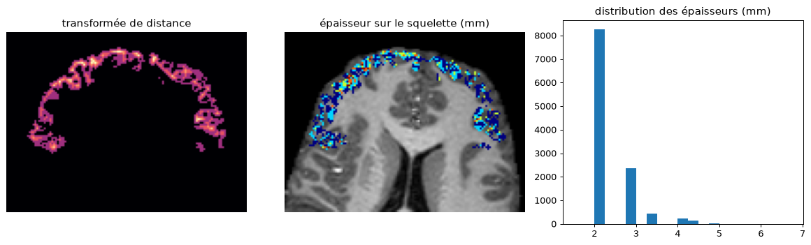

# Morphologie mathématique du cerveau et détection de l'ADHD

Peut-on distinguer un enfant ADHD d'un enfant contrôle à partir de la **forme** de son cerveau en IRM anatomique 3D ? Les données viennent de la base publique [ADHD-200](http://fcon_1000.projects.nitrc.org/indi/adhd200/), qui réunit des IRM de 6 hôpitaux.

Nous avons testé **deux approches**. Dans les deux cas, la forme du cerveau est décrite par des opérateurs de morphologie mathématique, puis classée par des modèles classiques, sans deep learning. L'évaluation se fait toujours sur un hôpital jamais vu pendant l'apprentissage (*leave-one-site-out*).

| | Approche 1 : morphologie seule | Approche 2 : lobe frontal |
|---|---|---|
| Dossier | [`approche1/`](approche1/) | [`approche2/`](approche2/) |
| Extraction du cerveau | morphologie (ouverture + reconstruction géodésique) | SynthStrip |
| Région étudiée | cerveau entier + 8 octants (sans atlas) | lobe frontal (recalage MNI + atlas Harvard-Oxford) |
| Enfants | 476 (5 hôpitaux) | 571 (5 hôpitaux) |
| Descripteurs | 129 (47 globaux + 82 régionaux) | 30 |
| Classification | sélection Boruta + forêt aléatoire | régression logistique, SVM, forêt aléatoire |
| AUC, morphologie seule | 0,55 à 0,57 | **0,60** (permutation p = 0,005) |

L'approche 1 montre les limites de la morphologie seule, sans connaissance anatomique : on ne sait pas viser le lobe frontal. L'approche 2 ajoute un atlas pour cibler cette région.

---

## Approche 1 : la morphologie mathématique seule

Aucun atlas, aucun recalage, aucun réseau de neurones : seulement les opérateurs du cours.

1. **Résolution** : rééchantillonnage isotrope à 1 mm. L'extraction du cerveau se fait sur une grille de 2 mm.
2. **Extraction du cerveau** :
   - seuil relatif à la matière blanche, puis érosion ;
   - ouverture euclidienne (r = 6 mm) qui coupe les ponts vers le crâne et la peau ;
   - reconstruction géodésique ;
   - fermeture, remplissage des trous et ouverture finale (r = 10 mm).
3. **Tissus** :
   - correction du biais ;
   - seuils Otsu ancrés sur la matière blanche ;
   - nettoyage par filtre alterné séquentiel ;
   - ventricules par reconstruction géodésique.
4. **Descripteurs** :
   - granulométrie et anti-granulométrie ;
   - top-hat, bottom-hat et gradient ;
   - transformée de distance (épaisseur) ;
   - nombre d'Euler ;
   - squelette ;
   - érosion ultime et diamètre géodésique ;
   - 8 octants autour du centre de masse, asymétries gauche-droite et texture en niveaux de gris.
5. **Classification** : harmonisation par site, retrait du volume intracrânien, de l'âge et du sexe dans chaque pli, sélection Boruta et forêt aléatoire.

| Fichier | Rôle |
|---|---|
| `approche1/src/preparation/data_inventory.py` | Inventaire des IRM T1 (lecture des en-têtes) |
| `approche1/src/preparation/metadata.py` | Lecture et harmonisation des fichiers `participants.tsv` |
| `approche1/src/preparation/cohort.py` | Tableau de la cohorte (diagnostic, âge, sexe, voxels) |
| `approche1/src/preparation/subset_children.py`, `subset_main.py` | Choix des enfants et des 5 hôpitaux retenus |
| `approche1/src/pipeline/run_pipeline.py` | Extraction du cerveau, tissus, opérateurs, 129 descripteurs |
| `approche1/src/pipeline/analysis.py` | Classification (Boruta + forêt aléatoire, leave-one-site-out) |
| `approche1/src/pipeline/univariate_check.py` | Comparaison descripteur par descripteur et contrôle de la qualité d'image |

Exécution depuis `approche1/` (les IRM sont attendues dans `approche1/ADHD200_BIDS/`) :

```
python src/preparation/data_inventory.py
python src/preparation/cohort.py
python src/preparation/subset_children.py
python src/preparation/subset_main.py
python src/pipeline/run_pipeline.py --all --n_jobs 4
python src/pipeline/analysis.py
python src/pipeline/univariate_check.py
```

---

## Approche 2 : le lobe frontal

1. **Données** : tableau propre de 650 enfants (6 hôpitaux).
2. **Prétraitement** :
   - retrait du crâne avec SynthStrip ;
   - recalage affine du modèle MNI152 sur chaque enfant avec SimpleITK (Dice moyen 0,945) ;
   - extraction du lobe frontal avec l'atlas Harvard-Oxford.
3. **Segmentation** : seuillage d'Otsu à 3 classes (LCR, matière grise, matière blanche), propre à chaque enfant.
4. **Morphologie mathématique** : 30 descripteurs par enfant, tous calculés dans [`approche2/scripts/morpho.py`](approche2/scripts/morpho.py).

   | Famille | Descripteurs | Nb |
   |---|---|---|
   | Volumes | lobe frontal / cerveau, fractions de matière grise, de matière blanche et de LCR | 4 |
   | Granulométrie (ouvertures de la matière grise, r = 1 à 3 mm) | fraction restante et spectre | 10 |
   | Anti-granulométrie (fermetures du tissu, r = 1 à 4 mm) | volume de sillons comblés | 4 |
   | Squelette + transformée de distance | épaisseur corticale (moyenne, écart-type, 90e centile), branches | 6 |
   | Gradient morphologique | surface / volume, gyrification | 2 |
   | Top-hat noir | sillons fins (moyenne, 90e centile) | 2 |
   | Nombre d'Euler | topologie de la matière grise | 1 |
   | Contraste | matière grise / matière blanche | 1 |

5. **Classification** :
   - harmonisation par site ;
   - régression logistique, SVM et forêt aléatoire ;
   - évaluation leave-one-site-out et test de permutation.




### Résultats

571 enfants de 5 hôpitaux. Chaque hôpital est testé sans avoir été vu à l'entraînement. Pittsburgh est exclu, car il n'a que des contrôles.

| Modèle | Balanced accuracy | AUC |
|---|---|---|
| Âge, sexe, QI | 66 % | 0,69 |
| Morphologie seule | 56 % | 0,60 |
| Morphologie + âge, sexe, QI | **67 %** | **0,72** |

Le signal morphologique est faible mais significatif : le test de permutation donne p = 0,005. Chez les enfants ADHD, le lobe frontal est en moyenne plus petit par rapport au reste du cerveau.


| Fichier | Rôle |
|---|---|
| `approche2/notebooks/01_preparation_donnees.ipynb` | Construction du tableau des enfants et exploration |
| `approche2/scripts/etape3_pretraitement.py` | Prétraitement de toutes les IRM (SynthStrip, recalage, lobe frontal) |
| `approche2/scripts/morpho.py` | Segmentation et opérateurs morphologiques (les 30 descripteurs) |
| `approche2/scripts/etape45_descripteurs.py` | Calcul des descripteurs pour tous les enfants |
| `approche2/notebooks/02_morphologie_classification.ipynb` | Classification et résultats |
| `approche2/models/` | Modèle MNI152, masque et lobe frontal (atlas Harvard-Oxford) |
| `approche2/data/processed/` | Descripteurs et résultats |

Exécution : placer les IRM dans `approche2/data/raw/` et le poids `synthstrip.1.pt` dans `approche2/models/`. Ensuite, exécuter dans l'ordre :
1. le notebook 01 ;
2. `etape3_pretraitement.py` ;
3. `etape45_descripteurs.py` ;
4. le notebook 02.

---

## Installation

```
python -m venv venv
pip install -r requirements.txt
```

Les IRM ADHD-200 et les poids de SynthStrip ne sont pas inclus dans le dépôt.

## Limites

- L'effet est faible : ce n'est pas un outil de diagnostic.
- Chaque hôpital a son propre scanner, et le contraste varie plus que la forme.
- Les enfants ADHD bougent davantage pendant l'IRM, ce qui peut imiter un amincissement du cortex.
- Le recalage est seulement affine : les frontières du lobe frontal sont précises à quelques mm près.

## Données

ADHD-200 Consortium (2012), *Frontiers in Systems Neuroscience*. Usage non commercial.

---
Montaha Trabelsi · Molka Achich
